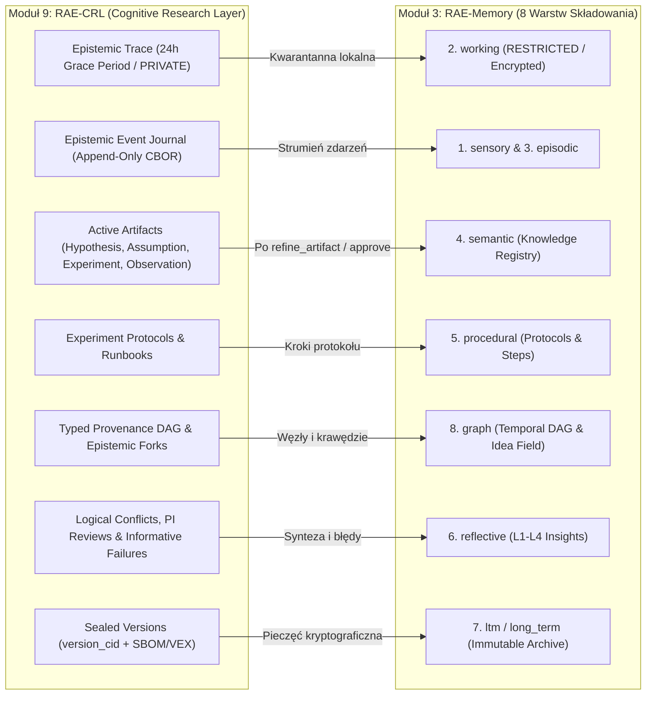

# 🚀 Iteracyjny Plan Migracji RAE-Suite i RAE-CRL do Go (`RAE-Go v4.0`)

**Status dokumentu:** Strategiczny Plan Architektoniczno-Wdrożeniowy v2.0 (Pełna Architektura Warstw Pamięci + `RAE-CRL`)  
**Data opracowania:** 2026-10-18  
**Zakres:** Kompletny ekosystem `RAE-Suite` + `RAE-Memory` (wszystkie warstwy i podwarstwy) + `RAE-CRL` (Cognitive Research Layer) + `RAE-Mesh` (9 niezależnych modułów + wspólne jądro `pkg/raecore`)  
**Paradygmat:** *Modular Monolith & Microservices Dual-Mode* | *Database-Agnostic* | *Device-Agnostic (`CGO_ENABLED=0`)* | *Strangler Fig Pattern (100% kompatybilności wstecznej API v2)*

---

## 1. Wizja i Nienaruszalne Filary („Duch RAE-Suite & RAE-CRL”)

Celem migracji ekosystemu `RAE-Suite` oraz `RAE-CRL` z Pythona do **Go (Golang 1.24+)** jest uzyskanie **10x–30x wyższej wydajności operacyjnej**, **15x–40x mniejszego zużycia pamięci RAM**, **natywnej wieloplatformowości dla `RAE-Mesh`** oraz **statycznych, jednoplikowych binarek**, przy **100% zachowaniu unikalnego DNA, warstwowości kognitywnej i rygoru naukowego RAE**:

1. **Pełna Wielowarstwowa Architektura Pamięci (`RAE-Memory` — 8 Warstw Składowania + 4 Poziomy Refleksji L1–L4 + 3 Silniki Matematyczne + Manifold Atlas)**:
   - Żadna warstwa ani strategia nie zostaje uproszczona czy pominięta — wszystkie warstwy składowania (`sensory`, `working`, `episodic`, `semantic`, `procedural`, `reflective`, `ltm`, `graph`), wszystkie 4 poziomy refleksji (`L1`–`L4`), wszystkie 9 strategii wyszukiwania oraz rejestr rewizji wiedzy (`Knowledge Registry & Supersedes`) zostają odwzorowane 1:1 w silnie typowanym Go.
2. **Warstwa Badań Kognitywnych i Ciągłości Epistemicznej (`RAE-CRL` — Cognitive Research Layer)**:
   - Pełne włączenie `RAE-CRL` jako **9. natywnego modułu `RAE-Go`** (`services/crl` & `cmd/rae-crl`, port `:8503` + MCP + CLI) oraz jako **Etapu 0 (Pre-Generation Research & Hypothesis Stage)** w głównym pipeline wykonawczym `AutonomyKernel`.
3. **Hard Frames & Zgodność z ISO/IEC 42001 oraz ISO/IEC 27000**:
   - Wkompilowana w kod maszynowy izolacja `INFO_CLASS` (`PUBLIC`, `INTERNAL`, `CONFIDENTIAL`, `RESTRICTED` — twarda blokada przed opuszczeniem warstwy `working` lub wysłaniem przez `RAE-Mesh` surowych danych `RESTRICTED` oraz śladów `RAE-CRL` objętych 24-godzinnym `Grace Period`).
   - Kryptograficzny Rejestr Audytowy (`SHA-256` / `BLAKE3-256` + deterministyczny `CBOR RFC 8949` + podpisy `HMAC-SHA256` / `Ed25519`).
4. **3-Stopniowa Hierarchia Multi-Modelowa (9 Modeli + Stopień 0 Local GPU)**:
   - **Stopień 0 (Local GPU — Node 1 Lumina RTX 4080 / $0.00)**: `deepseek-r1:8b`, `SpeakLeash/bielik-11b-v3.0-instruct:Q5_K_M`, `qwen3.5:9b`.
   - **Stopień I — GENERATE ($0.05–$0.12 / 1M)**: `z-ai/glm-5.3-flash`, `deepseek/deepseek-v4-flash`, `xiaomi/mimo-v2.5`.
   - **Stopień II — REVIEW & REPAIR ($0.66–$1.17 / 1M)**: `deepseek/deepseek-v4-pro-0813`, `z-ai/glm-5.3`, `moonshotai/kimi-k2.7-code`.
   - **Stopień III — JUDGE & CONSENSUS ($2.00–$2.55 / 1M)**: `openai/gpt-5.6-sol`, `moonshotai/kimi-k3`, `anthropic/claude-sonnet-5` + eskalacja L3 do `OpenClaw (Hermes-4-405B)` oraz bramki `Portal HITL`.

---

## 2. Kompletna Mapa Warstw `RAE-Memory` (Odwzorowanie 1:1 w Go)

Po dokładnym audycie kodu `rae-core`, `apps/memory_api`, schematu bazy danych PostgreSQL (38 tabel) oraz telemetrii, `RAE-Memory` w Go musi obejmować **wszystkie 4 wymiary warstwowości**:

### 2.1. Wymiar I — 8 Warstw Składowania i Retencji Danych (`MemoryLayer`)

| # | Warstwa (`MemoryLayer`) | Rola w ekosystemie RAE | Mechanizm retencji, bezpieczeństwa i indeksowania w Go (`pkg/raecore/layers`) |
| :--- | :--- | :--- | :--- |
| **1** | **`sensory`** *(Sensory Buffer)* | Ultrakrótkotrwały bufor wejściowy dla surowych bodźców, logów i strumienia telemetrii | Ścisły `expires_at` (`TTL`), automatyczne czyszczenie w tle przez ticker gorutyny (`SensoryDecayWorker`), bardzo niski koszt zapisu. |
| **2** | **`working`** *(Working Context)* | Aktywna pamięć operacyjna bieżącej sesji / zadania z limitem pojemności (*Attention Window*) | **Twarda bariera `RESTRICTED` (ISO 27000)**: szyfrowanie w locie `AES-256-GCM` / `ChaCha20-Poly1305`. Nigdy nie podlega eksportowi przez `RAE-Mesh`. Konsolidowana do warstw wyższych wyłącznie po deklasyfikacji/abstrakcji. |
| **3** | **`episodic`** *(Episodic Memory — `EM`)* | Autobiograficzny dziennik zdarzeń, interakcji A2A, uruchomień narzędzi i śladów błędów | `100% Implicit Capture` przez `IntelligentBridge`. Obsługuje **Szubar Mode** (`is_failure`, `failure_trace`, `decision_forks`, `epistemic_status`). Podlega stopniowemu zanikowi (`strength` decay) lub promocji do `semantic`. |
| **4** | **`semantic`** *(Semantic Knowledge — `SM`)* | Zdekontekstualizowana wiedza domenowa, fakty, architektura, kontrakty i standardy projektu | Powstaje z bezpośredniego zapisu lub awansu z `episodic` (`UpgradeToSemantic`). Powiązana z `Knowledge Registry` (`rae_knowledge_registry`, `rae_knowledge_revisions`, `rae_knowledge_supersedes`) i poziomem zaufania `SourceTrustLevel` (`high`/`medium`/`low`/`unverified`). |
| **5** | **`procedural`** *(Procedural Memory & Oracle)* | Pamięć operacyjno-instrukcyjna („jak wykonać”: playbooki, algorytmy krokowe, reguły przemysłowe OEE) | Dedykowany `ProceduralChunker` (respektujący granice kroków `Step 1 / Krok 1`), endpoint `/procedural/query` (`ProceduralOracle`), integracja z `ScreenWatcherBridge` oraz deterministyczny, regułowy fallback działający w trybie *LLM Offline*. |
| **6** | **`reflective`** *(Reflective Meta-Memory — `RM`)* | Syntetyczna meta-wiedza, wykryte wzorce, anomalie i „Lessons Learned” | Zasilana przez **4-poziomowy Silnik Refleksji (`L1`–`L4`)**. Przechowuje typy refleksji: `CONSOLIDATION`, `PATTERN`, `ANOMALY`, `META` wraz z grafem relacji (`reflection_relationships`, `reflection_audits`). |
| **7** | **`ltm` / `long_term`** *(Historical Archive & Sealed LTM)* | Długoterminowe archiwum skonsolidowanej wiedzy krytycznej oraz zapieczętowane wersje (`Sealed Versions` z `RAE-CRL`) | Przechowuje wiedzę o najwyższym współczynniku przetrwania (`importance` $\ge 0.85$, odporną na `Memory Decay`) oraz niezmienne rekordy z podpisem `version_cid` (`Multihash`). |
| **8** | **`graph`** *(Temporal Knowledge Graph & Idea Field)* | Warstwa topologiczno-relacyjna łącząca encje (`ENTITY`), relacje (`RELATIONSHIP`) i pole idei | Tabele `knowledge_graph_nodes`, `knowledge_graph_edges`, `idea_field_edges`. Obsługuje **Temporal Graph** (ewolucja relacji w czasie), **Community Detection** (`CommunityDetector` + `CommunitySummarizer`) oraz propagację energii rezonansu (`Semantic Resonance`). |

---

### 2.2. Wymiar II — 4 Poziomy Kognitywne Warstwy Refleksyjnej (`rae_core/reflection/layers`)
W przeciwieństwie do zwykłych systemów RAG, `RAE-Memory` w Go zachowuje pełny **4-warstwowy Kaskadowy Koordynator Refleksji (`ReflectionCoordinator`)**:

1. **`L1 Operational Reflection` (Deterministyczna Bramka Dowodowa)**:
   - `EvidenceVerifier` (weryfikacja pokrycia twierdzeń w źródłach — `coverage_ratio`),
   - `ContractEnforcer` (zgodność ze schematem i regułami twardymi),
   - `UncertaintyEstimator` (blokada odpowiedzi przy `uncertainty_level > max_uncertainty`).
2. **`L2 Structural Reflection` (Analiza Topologii i Kosztów)**:
   - `RetrievalAnalyzer` (wykrywanie brakujących źródeł, np. `missed_sources`),
   - `PatternDetector` (identyfikacja strukturalnych anomalii i korelacji w strumieniu danych),
   - `CostOptimizer` (dynamiczna korekta `increase_top_k` / `decrease_top_k` oraz logowanie oszczędności w `token_savings_log`).
3. **`L3 Meta-Field Reflection` (Tryb Szubara / QFT Renormalization)**:
   - `FieldDensityMonitor` (monitorowanie gęstości pola idei `idea_field_edges` i wyłaniających się klastrów),
   - `RenormalizationEngine` (weryfikacja spójności skali: wnioski w skali makro nie mogą przeczyć faktom w skali mikro),
   - `SymmetryAndAnomalyDetector` (wykrywanie twierdzeń bez dowodów — *symmetry break* — oraz wycieków między domenami bezpieczeństwa).
4. **`L4 Cognitive Reflection` („The Sage” — Synteza Mądrości)**:
   - Asynchroniczna synteza z udziałem modelu LLM (np. lokalnego `qwen3.5:9b` / `bielik-11b` na `Node 1`) destylująca z działań agenta reużywalne `Lessons Learned` zapisywane w warstwie `reflective` i `semantic`.

---

### 2.3. Wymiar III — 3 Poziomy Matematyczne, 3 Silniki Logic Gateway i `Manifold Atlas`
Cały pakiet `rae_core/math` oraz `rae_core/search` zostaje przeniesiony do `pkg/raecore/math` i `pkg/raecore/search`:

- **3 Poziomy Kontrolera Matematycznego (`MathLevel`)**:
  - `MathLevel.L1` (Szybkie heurystyki czasowo-częstotliwościowe $< 1\text{ ms}$),
  - `MathLevel.L2` (Entropia informacyjna, dynamika zaniku `dynamics.py`, stabilność `stability.py`, struktura grafowa `structure.py`),
  - `MathLevel.L3` (Wielo-ręki bandyta `MAB` z wykrywaniem dryfu i adaptacją wag $\alpha, \beta, \gamma$).
- **3 Silniki Wyszukiwania (`LogicGateway` + 9 Strategii w `search/strategies`)**:
  1. **Engine 1 — Heuristic (Fast Path $< 1\text{ ms}$)**: `anchor` (kotwice symboli/ID), `fulltext` (FTS5 / `tsvector` z obsługą wildcard `*`), `sparse` (BM25).
  2. **Engine 2 — Probabilistic (Resonance Path)**: `semantic_resonance`, `graph` oraz `graph_lite` (propagacja aktywacji po krawędziach grafu wiedzy).
  3. **Engine 3 — Neural & Multi-Vector (Deep Path)**: `vector`, `multi_vector` (*Named Vectors*: `dense`, `ollama`, `openai` bez obcinania wymiarów), `visual` + kwantyzacja binarna/skalarna (`quantization.py`, `quantization_bytes.py`) + `SmartReranker` (`api`, `mcp`, lokalny ONNX/Cross-Encoder) + `SufficiencyGate` i `ConflictDetector`.
- **Manifold Atlas (`pkg/raecore/math/manifold`)**:
  - Pełny rejestr historycznych i wyspecjalizowanych ramion matematycznych wybieranych przez MAB: `classic_ib` (System 1.0 — Information Bottleneck), `hyper_37` (System 37.0 — Exponential Rank Sharpening), `fluid_100` (System 100.0 — Dynamic Geometry via Entropy), `neural_22` (System 22.1), `doc_pro` (System 41.4).
- **Koperta Kontekstowa (`ContextEnvelope`)**:
  - Enkapsulacja metadanych pochodzenia (`provenance`, `source_owner`, `trust_level`, `sync_metadata`) bez zanieczyszczania surowej treści przekazywanej do okna kontekstowego.

---

## 3. Włączenie `RAE-CRL` (Cognitive Research Layer) do Architektury `RAE-Go`

`RAE-CRL` (`/home/grzegorz/cloud/RAE-CRL`) zostaje włączone do `RAE-Go v4.0` jako **9. pierwszoklasowy moduł (`services/crl` & `cmd/rae-crl`)**, zachowując 100% założeń z `README.md` oraz specyfikacji `RAE-CRL 2.2`:

### 3.1. Model Epistemiczny `RAE-CRL` w Go (`pkg/raecore/epistemic` & `services/crl`)

1. **7 Zamkniętych Typów Artefaktów Badawczych (`ArtifactType`)**:
   - `TRACE` (`epistemic_trace`) — szybka notatka (`quick_note`), wątpliwość lub szkic objęty **24-godzinnym okresem ochronnym (`Grace Period`)** i domyślną widocznością `PRIVATE` (chroniony przed synchronizacją `RAE-Mesh`),
   - `HYPOTHESIS` (`hypothesis`) — testowalne przewidywanie naukowe lub inżynieryjne (np. przyczyna błędu / cel optymalizacji),
   - `ASSUMPTION` (`assumption`) — aksjomaty, ograniczenia brzegowe i parametry kalibracji,
   - `EXPERIMENT` (`experiment`) — powtarzalny protokół badawczy wykonywany w izolowanym profilu `RAE-Hive`,
   - `OBSERVATION` (`observation`) — empiryczne pomiary, logi i surowe wyjścia z eksperymentu,
   - `DECISION` (`decision`) — decyzja architektoniczna lub pivot badawczy,
   - `REFLECTION` (`reflection`) — meta-kognitywne podsumowanie wyniku.
2. **Mechanizmy Human-Centric & Epistemicznego Bezpieczeństwa**:
   - **Wiedza Negatywna (`FAILED_BUT_INFORMATIVE` — `record_failure`)**: Nieudane eksperymenty są trwale zachowywane jako wysokowartościowe aktywa zapobiegające powtarzaniu ślepych uliczek (nigdy nie są kasowane ani nadpisywane).
   - **Rozgałęzienia Epistemiczne (`Epistemic Fork` — `fork_artifact`)**: Tworzenie alternatywnych interpretacji tych samych obserwacji połączonych typowaną krawędzią `has_alternative_interpretation` w grafie DAG.
   - **Nadzór Głównego Badacza (`PI Governance` — `request_approval` / `approve_artifact`)**: Formalna ścieżka akceptacji zdejmująca blokadę `Grace Period` i promująca artefakt do widoczności `TEAM` lub `PUBLIC`.
3. **Kryptograficzny Dziennik Zdarzeń i Paczki Dowodowe (Specyfikacja `RAE-CRL 2.2`)**:
   - **Typed Provenance DAG**: Skierowany graf acykliczny łączący wszystkie 7 typów artefaktów z automatycznym wykrywaniem sprzeczności logicznych (`Watchdog Logical-Conflict Detection`).
   - **Deterministyczny Kodek `CBOR (RFC 8949)` + Hashowanie `BLAKE3-256 / SHA-256`**: Identyfikatory `UUIDv7` (`artifact_id`, `event_id`, `execution_id`, `transfer_id`), `ULID` (`tenant_id`, `project_id`) oraz niezmienny `version_cid` (`Multihash`) dla zapieczętowanych wersji (`Sealed Versions`).
   - **Paczki Dowodowe (`Evidence Packages`) i `CMT` (*Consensual Memory Transfer*)**: Podpisane kryptograficznie, weryfikowalne offline paczki publikacyjne zawierające manifesty **SBOM, VEX oraz ML-BOM**, wymieniane przez `RAE-Mesh` za jawną zgodą odbiorcy.

### 3.2. Dwukierunkowe Mapowanie `RAE-CRL` $\leftrightarrow$ Warstwy `RAE-Memory`



### 3.3. Cztery Natywne Interfejsy `RAE-CRL` w Go (`cmd/rae-crl`)
1. **Web Lab Desk & REST API (`:8503`)**: Wysokokontrastowy pulpit badawczy (zgodny z WCAG, wbudowany w binarkę przez `//go:embed`) + pełne API REST integrowane również w widoku `RaeCrl` wewnątrz `RAE-Portal` (`:8082`).
2. **Natywny Serwer MCP (`stdio` + `/mcp/sse`)**: Narzędzia dla agentów (`Hermes`, `Claude`, `Gemini`): `quick_note`, `refine_artifact`, `record_failure`, `fork_artifact`, `list_my_traces`, `request_approval`, `approve_artifact`.
3. **Narzędzie CLI (`rae-crl`)**: `rae-crl init`, `rae-crl add <type>`, `rae-crl query`, `rae-crl fork`, `rae-crl seal`, `rae-crl export-evidence`.
4. **Etap 0 w `AutonomyKernel` (`ResearchStage`)**: Przed wygenerowaniem pierwszego bajtu kodu przez `LayerTriadRunner`, orkiestrator wykonuje w `RAE-CRL` fazę hipotez i badań (Read-Only AST & Dependency Graph Inspection).

---

## 4. Agnostyczność Bazodanowa, Urządzeniowa i Niezależność Modułowa

### 4.1. Agnostyczność Bazodanowa (`pkg/raecore/ports` + `pkg/drivers`)
Wszystkie 9 modułów (w tym `RAE-Memory` i `RAE-CRL`) korzysta wyłącznie z abstrakcyjnych portów Go, co pozwala uruchomić je na dowolnym silniku przechowywania:

| Port w `pkg/raecore/ports` | Profil `cluster` / `cloud` (K8s, Serwery) | Profil `edge` / `light` (Laptop, RPi, Terminal, Offline Lab) | Profil `hybrid` (`RAE-Mesh` Smart Node) |
| :--- | :--- | :--- | :--- |
| **`MemoryStoragePort`** *(8 warstw + Knowledge Registry)* | **PostgreSQL** (`jackc/pgx/v5` + `JSONB` + `tsvector`) | **Pure-Go SQLite** (`modernc.org/sqlite` z `FTS5` i `JSON1`, `CGO_ENABLED=0`) | Lokalny SQLite (`< 1 ms`) + asynchroniczna synchronizacja delt |
| **`EpistemicStoragePort`** *(`RAE-CRL` DAG + CBOR Journal)* | **PostgreSQL** (wspólna lub dedykowana baza z tabelami `baseartifact`, `artifactrelation`, `epistemic_journal`) | **Pure-Go SQLite** (`rae_crl.db` — pełna praca *Offline-First* w izolowanym laboratorium) | Lokalny `rae_crl.db` + `SyncEngine` respektujący 24h `Grace Period` i `CMT` |
| **`VectorSearchPort`** *(*Named Vectors*)* | **Qdrant** (gRPC z nazwanymi przestrzeniami: `dense`, `ollama`, `openai`) lub `pgvector` | **Native Go HNSW** (wbudowany w binarkę wielowymiarowy indeks *Named Vectors* z plikiem `.hnsw.wal`) | Lokalny HNSW + synchronizacja przestrzeni wektorowych z Qdrantem |
| **`OutboxQueuePort`** | **PostgreSQL `FOR UPDATE SKIP LOCKED`** + **Redis** | **SQLite Transactional Outbox** + wewnętrzne kanały Go (`chan OutboxEvent`) | Lokalny Outbox gwarantujący dostarczenie po odzyskaniu łączności |

### 4.2. Agnostyczność Urządzeniowa (`CGO_ENABLED=0` — `RAE-Mesh Everywhere`)
- **Zero zależności C/C++**: Pojedyncza kompilacja skrośna generuje statyczne binarki dla `linux/amd64`, `linux/arm64`, `linux/armv7` (Raspberry Pi / terminale przemysłowe), `windows/amd64` (`.exe`), `darwin/arm64` (macOS M1–M4) oraz biblioteki mobilne `.aar` (Android) i `.xcframework` (iOS) przez `gomobile bind`.

### 4.3. Struktura 9 Modułów („Każdy Moduł Osobno LUB Wszystkie Razem”)

```
RAE-Suite/
├── go.work
├── pkg/
│   ├── raecore/           # 8 warstw pamięci, L1-L4 Reflection, Math L1-L3, Manifold Atlas,
│   │                      # Epistemic DAG, CBOR (RFC 8949), BLAKE3/SHA-256, Hard Frames, Porty
│   ├── drivers/           # Adaptery: postgres, sqlite, qdrant, hnsw, redis, memorybus
│   └── raemesh/           # P2P Sync, Merkle-Tree Delta, CMT (Consensual Memory Transfer), mDNS
├── services/
│   ├── memory/            # Moduł 3: RAE-Memory (8 warstw, L1-L4, 9 strategii search, Outbox)
│   ├── crl/               # Moduł 9: RAE-CRL (7 artefaktów, 24h Grace Period, DAG, CBOR, Lab Desk)
│   ├── mcp/               # Moduł 2: RAE-MCP Server (SSE + Stdio dla RAE-Suite i RAE-CRL)
│   ├── orchestrator/      # Moduł 1: RAE-Suite Core (ResearchStage + AutonomyKernel + LayerTriad)
│   ├── quality/           # Moduł 4: RAE-Quality (AST Scanner, Security, Tribunal, Mutation)
│   ├── lab/               # Moduł 7: RAE-Lab (MAB Tuner, Candidate Guardrails, Offline Replay)
│   ├── phoenix/           # Moduł 5: RAE-Phoenix (Impact Graph, Behavioral Parity, Repair 3x)
│   ├── hive/              # Moduł 6: RAE-Hive (Isolation Profiles, Semantic Watchdog, Swarm k<=3)
│   └── portal/            # Moduł 8: RAE-Portal (14 widoków w tym RaeCrl, PWA, HITL HMAC-SHA256)
└── cmd/
    ├── rae-memory/        # Samodzielna binarka :8000
    ├── rae-crl/           # Samodzielna binarka :8503 + MCP + CLI (rae-crl init/add/query/seal)
    ├── rae-mcp/           # Samodzielna binarka :8005 + stdio
    ├── rae-suite/         # Samodzielna binarka :8009
    ├── rae-quality/       # Samodzielna binarka :8010 + CLI
    ├── rae-lab/           # Samodzielna binarka :8011
    ├── rae-phoenix/       # Samodzielna binarka :8012 + CLI
    ├── rae-hive/          # Samodzielna binarka :8013
    ├── rae-portal/        # Samodzielna binarka :8082
    └── rae/               # Zunifikowany Runner (np. rae serve --all lub --modules=memory,crl,mcp)
```

---

## 5. Plan Iteracyjny Migracji (Iteracje 0 – 9)

### 🔹 Iteracja 0: Fundamenty — `pkg/raecore`, Wszystkie Typy Warstw, Kodek `CBOR/BLAKE3` i Sterowniki Bazodanowe
1. **Pełny model danych `RAE-Memory` i `RAE-CRL` (`pkg/raecore/models`)**:
   - Wszystkie 8 warstw `MemoryLayer` (`sensory`, `working`, `episodic`, `semantic`, `procedural`, `reflective`, `ltm`, `graph`), `MemoryType` (`text`, `code`, `image`, `document`, `conversation`, `reflection`, `entity`, `relationship`), `ContextEnvelope`, `SourceTrustLevel`, `InformationClass`.
   - Wszystkie 7 typów artefaktów `RAE-CRL` (`epistemic_trace`, `hypothesis`, `assumption`, `experiment`, `observation`, `decision`, `reflection`), statusy (`draft`, `active`, `completed`, `failed_but_informative`, `deprecated`), widoczność (`private`, `team`, `public`) i `grace_period_end`.
   - Identyfikatory `UUIDv7`, `ULID`, `Multihash (version_cid)` oraz deterministyczny koder `CBOR (RFC 8949)` z hashowaniem `BLAKE3-256` i `SHA-256`.
2. **Warstwa Matematyczna i `Manifold Atlas` (`pkg/raecore/math`)**:
   - Poziomy `MathLevel` (`L1`, `L2`, `L3`), `MABTuner`, kwantyzacja wektorów (`quantization`, `quantization_bytes`), `SemanticResonance` oraz wszystkie ramiona `Manifold Atlas` (`classic_ib`, `hyper_37`, `fluid_100`, `neural_22`, `doc_pro`).
3. **Wymienne Sterowniki Bazodanowe (`pkg/drivers`)**:
   - Implementacja i wspólny zestaw testów kontraktowych (`StorageContractTestSuite`) dla `postgres` (`pgx/v5`), `sqlite` (`modernc.org/sqlite`), `qdrant` (gRPC *Named Vectors*) oraz `embedded_hnsw` (czyste Go *Named Vectors*).

---

### 🔹 Iteracja 1: Moduł 2 (`rae-mcp`) — Zunifikowany Serwer MCP (Stdio + SSE) dla `RAE-Suite` i `RAE-CRL`
1. Natywna binarka `cmd/rae-mcp` obsługująca transporty `stdio` i `HTTP SSE (:8005)`.
2. Wystawienie zarówno 9 narzędzi wykonawczych `RAE-Suite` (`rae_memory_*`, `rae_quality_audit`, `rae_phoenix_*`, `rae_sandbox_*`, `rae_cluster_dispatch`, `rae_consolidate_traces`), jak i 7 narzędzi badawczych `RAE-CRL` (`quick_note`, `refine_artifact`, `record_failure`, `fork_artifact`, `list_my_traces`, `request_approval`, `approve_artifact`).
3. Bezpieczne uruchamianie procesów bez `shell=True` i natychmiastowy start CLI (`< 5 ms`).

---

### 🔹 Iteracja 2: Moduł 9 (`rae-crl`) — Cognitive Research Layer (Silnik Epistemiczny, CLI, MCP i Lab Desk `:8503`)
1. **Rdzeń Epistemiczny (`services/crl`)**:
   - Zarządzanie cyklem życia 7 artefaktów badawczych z **24-godzinnym okresem ochronnym (`Grace Period`)** dla `TRACE`.
   - Obsługa `FAILED_BUT_INFORMATIVE` (trwała ochrona wiedzy negatywnej przed usunięciem), `Epistemic Fork` (`has_alternative_interpretation`) oraz przepływu `PI Governance` (`request_approval` / `approve_artifact`).
   - **Typed Provenance DAG** z detekcją cykli i operatorem wykrywania sprzeczności logicznych (`Watchdog Logical-Conflict Detection`).
   - **Append-Only Epistemic Event Journal** zapisywany w kanonicznym `CBOR` z łańcuchem skrótów `BLAKE3-256 / SHA-256`.
   - Generator i weryfikator podpisanych **Paczek Dowodowych (`Evidence Packages` z SBOM / VEX / ML-BOM)** do weryfikacji offline.
2. **Mostek Synchronizacji `SyncEngine` (`RAE-CRL` $\leftrightarrow$ `RAE-Memory`)**:
   - Automatyczna projekcja zatwierdzonych artefaktów i zdarzeń dziennika na odpowiednie warstwy `RAE-Memory` (`working`, `sensory`, `episodic`, `semantic`, `procedural`, `reflective`, `ltm`, `graph`), ze ścisłą blokadą eksportu śladów prywatnych przed upływem `grace_period_end`.
3. **Trzy Interfejsy w Jednej Binarce `cmd/rae-crl`**:
   - Serwer HTTP + Web Lab Desk na porcie `:8503`,
   - Serwer MCP (`rae-crl mcp`),
   - Kompletne narzędzie CLI (`rae-crl init`, `rae-crl add`, `rae-crl query`, `rae-crl fork`, `rae-crl seal`, `rae-crl verify`).

---

### 🔹 Iteracja 3: Moduł 4 (`rae-quality`) — Wielowątkowy Skaner Bezpieczeństwa, AST, SAST/SCA i Trybunał Jakości
1. Wielowątkowy skaner AST i bezpieczeństwa kodu (na puli gorutyn) weryfikujący złożoność, sekrety, podatności, reguły `C6 (project-relative only)` z `RAE-CRL` oraz bramki `UI Freeze`, `Functional Freeze` i `Imposition Freeze`.
2. Równoległy `MutationRunner` i `TestAggregator` bez zahardkodowanych ścieżek.
3. `QualityTribunal` z fizyczną separacją puli modeli recenzentów (`tier2_review_repair`) od sędziów (`tier3_judge`) oraz weryfikacją podpisów obrazów i manifestów SBOM przed zapieczętowaniem wersji (`Seal Gate`).

---

### 🔹 Iteracja 4: Moduł 6 (`rae-hive`) — Rój Wykonawczy, Profile Izolacji Eksperymentów i Semantic Watchdog
1. **Profile Izolacji `RAE-Hive` (zgodne z sekcją 11–12 specyfikacji `RAE-CRL 2.2`)**:
   - Wykonywanie zadań kodowych i eksperymentów naukowych w efemerycznych przestrzeniach roboczych z kontrolą `cgroups v2`, izolacją przestrzeni nazw Linuksa (`namespaces`), domyślną blokadą sieci (`Default-Deny Egress`) i zapisem proweniencji wykonania (`execution_id` UUIDv7).
   - `RunParallelCommands` ($k \le 3$ równoległe gałęzie wykonawcze).
2. **`TacticalSemanticWatchdog` (`WatchdogLoop`)**:
   - Detekcja pętli semantycznych (`Anti-Echo` — podobieństwo $> 0.90$ lub $\ge 3$ odrzucenia $\rightarrow$ `BLOCKED_LOOP`),
   - Detekcja zawieszeń (`Anti-Hang` — brak pulsu AST $> 120\text{ s}$),
   - Detekcja kandydatów na konflikty logiczne w grafie `RAE-CRL`.

---

### 🔹 Iteracja 5: Moduł 5 (`rae-phoenix`) — Silnik Autonomicznego Refaktoringu i Behavioral Parity
1. Wielowątkowy `ImpactAnalyzer` budujący graf zależności i promień rażenia zmian.
2. `BehaviorComparisonEngine` weryfikujący parzystość behawioralną przed zatwierdzeniem łatki.
3. Zamknięta pętla naprawcza (`PHOENIX_MAX_ATTEMPTS=3`) z automatycznym `git revert` i zapisem nieudanych prób jako `FAILED_BUT_INFORMATIVE` w `RAE-CRL` oraz `FailureLearningRecord` w `RAE-Memory`.

---

### 🔹 Iteracja 6: Moduł 7 (`rae-lab`) — Laboratorium Ewolucyjne, Optymalizacja Kaizen/MAB i Candidate Guardrails
1. `MetricsAggregator` i `MABTuner` optymalizujący wagi $\alpha, \beta, \gamma$ oraz wybór ramienia z `Manifold Atlas` w zadeklarowanych granicach bezpieczeństwa (bez możliwości osłabienia bramek konstytucyjnych).
2. Automatyczne generowanie reguł obronnych `CANDIDATE` (`GET /api/guardrails/candidates`) na podstawie błędów z `RAE-Phoenix` i wiedzy negatywnej z `RAE-CRL`.
3. `OfflineReplayOrchestrator` do walidacji hipotez na śladach historycznych.

---

### 🔹 Iteracja 7: Moduł 3 (`rae-memory`) & `RAE-Mesh` — Pełny 8-Warstwowy Silnik Pamięci, L1–L4 Reflection i CMT
1. **Kompletna implementacja wszystkich 8 warstw w `services/memory` (`:8000`)**:
   - Obsługa `sensory` (TTL decay), `working` (szyfrowanie `RESTRICTED`), `episodic` (Szubar Mode), `semantic` (`Knowledge Registry`, rewizje i `supersedes`), `procedural` (`ProceduralChunker` + `/procedural/query` + `ScreenWatcherBridge`), `reflective` (`ReflectionCoordinator` **L1 Operational $\rightarrow$ L2 Structural $\rightarrow$ L3 Meta-Field $\rightarrow$ L4 Cognitive Sage**), `ltm` (`Sealed Versions` + archiwum odporne na decay) oraz `graph` (`TemporalGraph` + `CommunityDetector` + `POST /v2/knowledge/resolve`).
2. **Wszystkie 9 Strategii Wyszukiwania i 3 Silniki Logic Gateway**:
   - `anchor`, `fulltext`, `sparse`, `vector`, `multi_vector` (*Named Vectors*), `graph`, `graph_lite`, `visual` + `SmartReranker` + `SufficiencyGate` + `ConflictDetector`.
3. **Wbudowany `OutboxDispatcher` i `MemoryDecayScheduler` (zamiast osobnych kontenerów Celery Worker/Beat)**:
   - Natywne gorutyny przetwarzające `rae_governance_outbox` (`FOR UPDATE SKIP LOCKED` / SQLite WAL), konsolidację `working` $\rightarrow$ `episodic`/`semantic` oraz okresowe wygaszanie `sensory`.
4. **`RAE-Mesh v2` i `CMT` (*Consensual Memory Transfer*)**:
   - Synchronizacja oparta o drzewo skrótów **Merkle-Tree (`BLAKE3-256` / `SHA-256`)** oraz protokół **CMT** wymagający tokenów uprawnień (`Capability Tokens`), zgodności polityk klasyfikacji i podpisanych pokwitowań kryptograficznych między węzłami (`Laptop`, `Cloud`, `Node 1`, `Node 2`, `Node 3`).

---

### 🔹 Iteracja 8: Moduł 1 (`rae-suite`) — Orkiestrator Główny z Etapem 0 (`RAE-CRL ResearchStage`), `AutonomyKernel` i `LayerTriadRunner`
1. **Włączenie Etapu 0 (`Pre-Generation Research & Hypothesis Stage`) w `AutonomyKernel`**:
   - Każde złożone zadanie inżynieryjne rozpoczyna się od rejestracji hipotezy w `RAE-CRL` i walidacji na czytniku AST/grafie zależności przed wejściem w fazę generowania kodu (`CODING`).
2. **Współbieżny `LayerTriadRunner`**:
   - Natywna obsługa 3-stopniowej kaskady 9 modeli (`tier1_generate` $\rightarrow$ `tier2_review_repair` $\rightarrow$ `tier3_judge`) oraz lokalnego GPU na `Node 1` (`deepseek-r1:8b`, `bielik-11b`, `qwen3.5:9b`) i eskalacji do `OpenClaw (Hermes-4-405B)`.
3. **`RAE_CEO_Orchestrator` (`POST /v2/orchestrator/reconcile`) & `ComputeFabricRouter` (`GET /v2/fabric/route`)**.

---

### 🔹 Iteracja 9: Moduł 8 (`rae-portal`) oraz Zunifikowana Binarka `cmd/rae` (All-in-One Edge, Desktop & Mobile)
1. **`rae-portal` (`:8082`)**:
   - Wszystkie 14 widoków operacyjnych (w tym zintegrowany widok **`RaeCrl`** łączący się z `:8503`, `MissionControl`, `SearchConsole`, `DecayRetention`, `EvolutionLab`, `PhoenixRepair`, `HiveSandbox`, `OpenClawEscalation`, `MeshFederation`, `CentralAuditor`, `PDKnowledgeHub`),
   - Wbudowany przez `//go:embed` Service Worker PWA (`/sw.js`, `/manifest.json`, `IndexedDB` cache), koncentrator WebSockets oraz kryptograficzna bramka `HITL Approval` (`HMAC-SHA256`).
2. **Zunifikowany Runner `cmd/rae` (`Modular Monolith Mode`)**:
   - Możliwość uruchomienia każdego z 9 modułów osobno (`cmd/rae-memory`, `cmd/rae-crl`, `cmd/rae-mcp`, `cmd/rae-suite`, `cmd/rae-quality`, `cmd/rae-lab`, `cmd/rae-phoenix`, `cmd/rae-hive`, `cmd/rae-portal`) **LUB** dowolnej ich kombinacji w jednej binarce:
     - `rae serve --all --profile=edge` (wszystkie 9 modułów w jednym procesie ~`40 MB RAM` z lokalnym SQLite i HNSW),
     - `rae serve --modules=memory,crl,mcp --profile=researcher` (lekki pakiet naukowo-badawczy dla stacji roboczej lub laptopa w laboratorium offline).

---

## 6. Podsumowanie Architektoniczne (100% Pokrycia Ekosystemu)

| Komponent / Warstwa | Ujęcie w planie `RAE-Go v4.0` | Tryb uruchomienia |
| :--- | :--- | :--- |
| **8 Warstw Składowania `RAE-Memory`** (`sensory`, `working`, `episodic`, `semantic`, `procedural`, `reflective`, `ltm`, `graph`) | ✅ Pełne odwzorowanie 1:1 w `pkg/raecore/layers` i `services/memory` | `cmd/rae-memory` (`:8000`) lub wewnątrz `cmd/rae` |
| **4 Poziomy Refleksji Kognitywnej** (`L1 Operational`, `L2 Structural`, `L3 Meta-Field Szubar`, `L4 Cognitive Sage`) | ✅ Pełne odwzorowanie 1:1 w `pkg/raecore/reflection` | `cmd/rae-memory` (`:8000`) |
| **3 Silniki Matematyczne + `Manifold Atlas` + 9 Strategii Search** (`anchor`, `fulltext`, `sparse`, `vector`, `multi_vector`, `graph`, `graph_lite`, `visual`, `SmartReranker`) | ✅ Pełne odwzorowanie 1:1 w `pkg/raecore/math` i `pkg/raecore/search` | `cmd/rae-memory` (`:8000`) |
| **`RAE-CRL` (Cognitive Research Layer)** — 7 artefaktów (`TRACE` 24h Grace Period, `HYPOTHESIS`, `ASSUMPTION`, `EXPERIMENT`, `OBSERVATION`, `DECISION`, `REFLECTION`), `FAILED_BUT_INFORMATIVE`, `Epistemic Fork`, `PI Governance`, `CBOR + BLAKE3`, `SBOM/VEX Evidence Packages` | ✅ Pełny 9. moduł w `services/crl` + Etap 0 w `AutonomyKernel` | `cmd/rae-crl` (`:8503` + MCP + CLI) lub wewnątrz `cmd/rae` |
| **Agnostyczność Bazodanowa** (`PostgreSQL` / `Pure-Go SQLite` + `Qdrant` / `Native Go HNSW` + `Redis` / `SQLite WAL Outbox`) | ✅ Przełączane flagą `--profile=cluster\|edge\|hybrid` bez rekompilacji | Wszystkie 9 modułów |
| **Agnostyczność Urządzeniowa (`CGO_ENABLED=0`)** | ✅ `linux/amd64`, `linux/arm64`, `windows/amd64`, `darwin/arm64`, `gomobile` (`.aar`/`.xcframework`) | Wszystkie 9 modułów |
